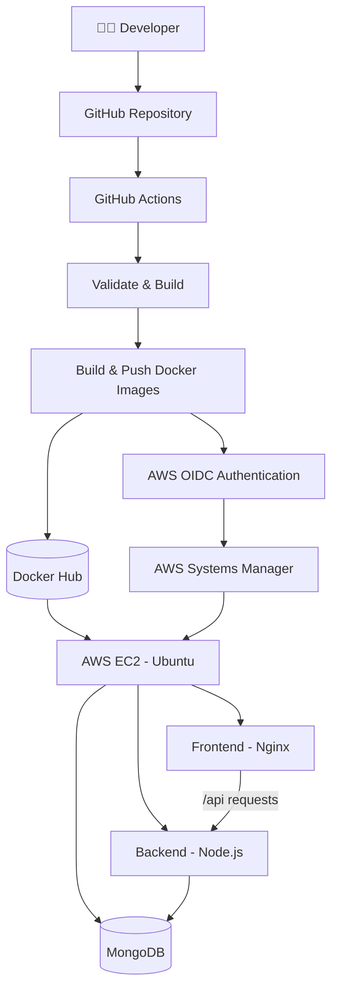

<!-- HEADER -->
<div align="center">

# ⚡ Todo DevOps Project

### Automated CI/CD • Infrastructure as Code • AWS Cloud Deployment

<p>
  
  
  
  
</p>

<p>
  
  
  
</p>

**A hands-on DevOps project demonstrating automated application deployment on AWS.**

</div>

---

## 🧑‍💻 About the Project

Todo DevOps Project demonstrates an end-to-end deployment workflow for a containerized Todo application. It combines Infrastructure as Code, configuration management, containerization, and CI/CD automation to simplify deployment and server management.

<table>
<tr>
<td width="50%" valign="top">

### 🚀 CI/CD Automation
Automated validation, frontend builds, Docker image creation, publishing, and deployment using GitHub Actions.

</td>
<td width="50%" valign="top">

### ☁️ AWS Infrastructure
Provision cloud infrastructure using Terraform and configure the application server using Ansible.

</td>
</tr>
<tr>
<td width="50%" valign="top">

### 📦 Containerization
Package the frontend and backend into Docker images and run application services using Docker Compose.

</td>
<td width="50%" valign="top">

### 🔐 Secure Deployment
Use GitHub OIDC for AWS authentication and Systems Manager to execute deployment commands without SSH-based CI/CD access.

</td>
</tr>
</table>

## 🏗️ Architecture



## 🛠️ Tech Stack

<div align="center">

| Category | Technologies |
|:---|:---|
| **Frontend** | React, Vite, Nginx |
| **Backend** | Node.js, Express |
| **Database** | MongoDB 7 |
| **Containers** | Docker, Docker Compose |
| **CI/CD** | GitHub Actions |
| **Registry** | Docker Hub |
| **Infrastructure** | Terraform, AWS EC2 |
| **Configuration Management** | Ansible |
| **AWS Security & Deployment** | IAM, OIDC, Systems Manager |
| **Operating System** | Ubuntu 24.04 LTS |

</div>

## 🔄 CI/CD Pipeline

<table>
<tr>
<td align="center" width="33%">

### 01

**Validate & Build**

- Install dependencies
- Check backend syntax
- Lint and build frontend
- Validate Compose
- Build Docker images

</td>
<td align="center" width="33%">

### 02

**Publish Images**

- Authenticate to Docker Hub
- Build frontend image
- Build backend image
- Publish configured tags

</td>
<td align="center" width="33%">

### 03

**Deploy to AWS**

- Authenticate through OIDC
- Send commands using SSM
- Pull container images
- Update running services

</td>
</tr>
</table>

Workflow file: `.github/workflows/ci-cd.yml`

## ☁️ Infrastructure as Code

### Terraform

Terraform provisions the AWS infrastructure:

- Ubuntu 24.04 LTS EC2 instance
- Configurable EC2 instance type
- 8 GB `gp3` root volume
- Security group for HTTP and restricted SSH
- EC2 key pair

**Default configuration:** `eu-north-1` region and `t3.micro` instance type.

```bash
cd terraform
terraform init
terraform validate
terraform plan
terraform apply
```

> ⚠️ Review the Terraform plan before applying changes. AWS resources may incur charges.

The local Terraform provider uses the AWS CLI profile `todo-devops-process`. Configure this profile before running Terraform.

### Ansible

The Ansible playbook automates server configuration by:

- Updating the Ubuntu package cache
- Installing Docker and Docker Compose v2
- Enabling the Docker service
- Creating `/opt/todo-app`
- Writing the production Compose configuration
- Validating and starting application containers

## 🐳 Docker Services

| Container | Responsibility | Port |
|:---|:---|:---:|
| `todo-frontend` | Frontend served by Nginx | `80` |
| `todo-backend` | Todo API | `5000` |
| `todo-mongodb` | Persistent database storage | `27017` internally |

**Docker Hub images**

- `ahmad459/todo-devops-frontend`
- `ahmad459/todo-devops-backend`

MongoDB uses a persistent Docker volume. The current Ansible configuration expects the external volume `todo-deployment_todo-mongodb-data` to exist before deployment.

## 📂 Repository Structure

```text
todos-devops-project/
├── .github/
│   └── workflows/
│       └── ci-cd.yml
├── ansible/
│   ├── inventory.ini
│   └── playbook.yml
├── backend/
├── frontend/
├── terraform/
│   ├── main.tf
│   ├── provider.tf
│   ├── variables.tf
│   └── versions.tf
├── docker-compose.yml
├── .gitignore
└── README.md
```

## 🔐 Security Practices

- GitHub OIDC authentication instead of long-lived AWS access keys in CI/CD.
- AWS Systems Manager for deployment command execution.
- Restricted SSH ingress through an administrator IP allowlist.
- GitHub Actions secrets for Docker Hub credentials.
- `.gitignore` rules for Terraform state, variable files, environment files, and private keys.

**Never commit** access tokens, private keys, credentials, `.env` files, or Terraform state files.

## ✅ Deployment Verification

Check container status on the EC2 instance:

```bash
cd /opt/todo-app
sudo docker compose -f compose.yaml ps
```

Inspect backend logs:

```bash
sudo docker logs --tail 50 todo-backend
```

Test the API through the Nginx proxy:

```bash
curl -i http://localhost/api/todos
```

The response status and body depend on the API implementation.

## 🚀 Future Improvements

- [ ] HTTPS with a domain and TLS certificate
- [ ] Automated API integration tests
- [ ] Docker image vulnerability scanning
- [ ] Centralized logging and monitoring
- [ ] Deployment rollback strategy
- [ ] Separate staging and production environments

---

<div align="center">

## 👨‍💻 Created by Muhammad Ahmed Raza

**Junior DevOps Engineer | Cloud & Automation Enthusiast**

<a href="https://github.com/Ahmad-000">
  
</a>
<a href="https://linkedin.com/in/muhammad-ahmed-raza-devops/">
  
</a>

*Learning by building. Automating with DevOps.*

</div>
